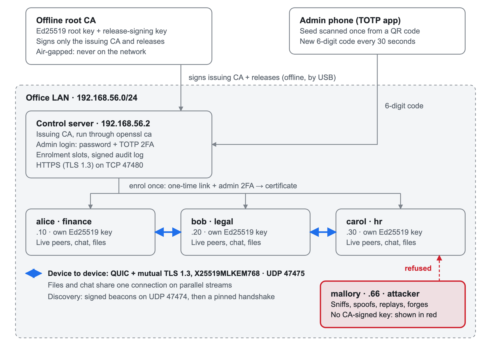
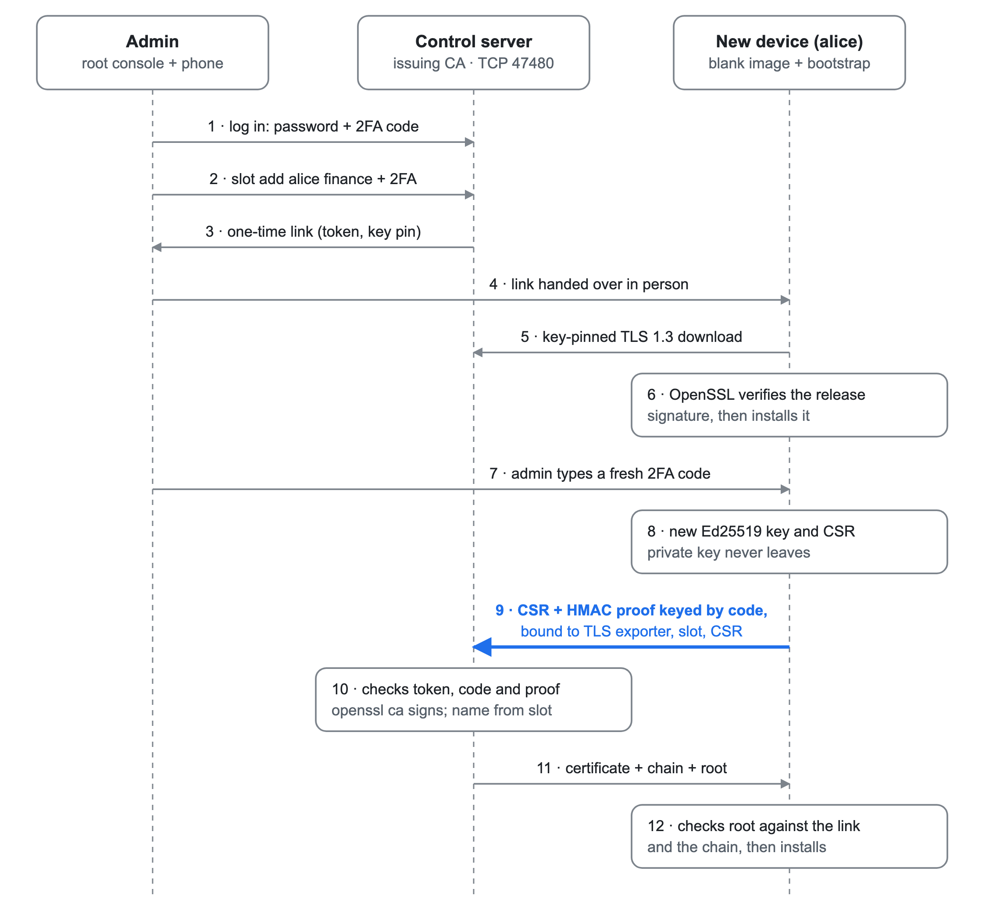
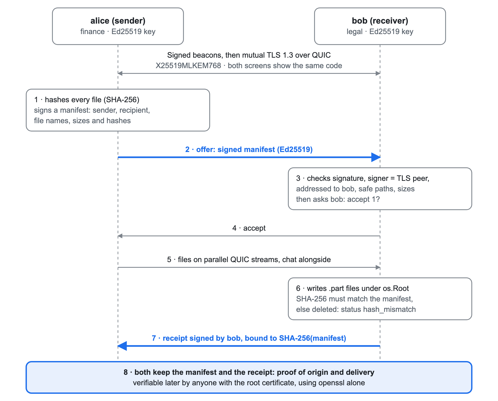
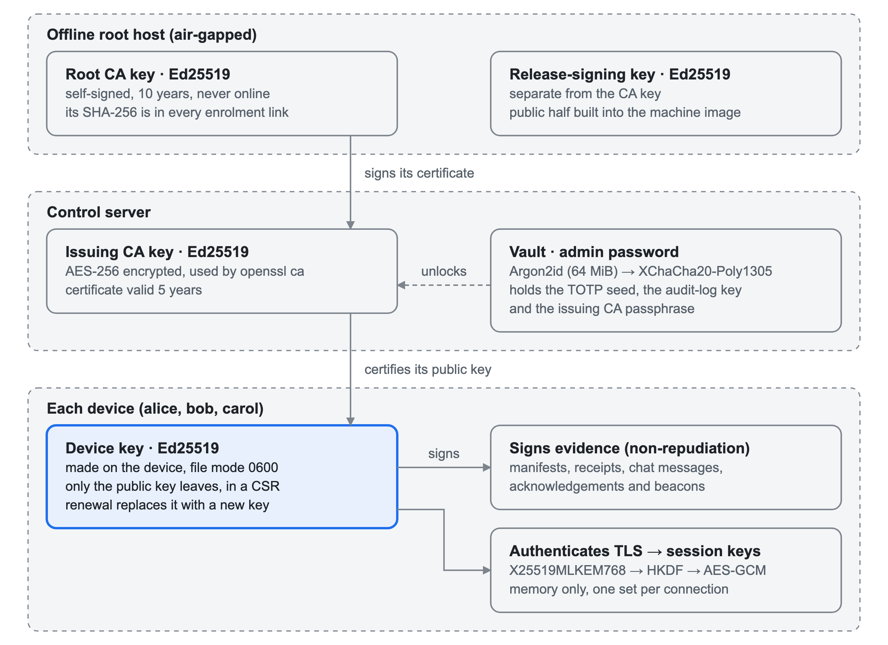

# CipherDrop

**Secure CLI-based LAN file transfer and messaging using TLS 1.3.**

CipherDrop lets a small group of high-privilege machines on one office network
send files and chat safely, even when the network itself is hostile.

- Every connection is **QUIC with mutual TLS 1.3**.
- The key exchange is the **hybrid post-quantum group X25519MLKEM768**.
- A machine can join only with a **one-time link** plus the administrator's
  live **Google Authenticator code**. Its certificate comes from an
  **OpenSSL certificate authority**.
- **Ed25519-signed manifests and receipts** prove who sent a file and that it
  arrived unchanged. Anyone can check this later with plain OpenSSL.

Group project for **MACS902 Modern Cryptography**.

---

## Contents

1. [Security at a glance](#security-at-a-glance)
2. [Architecture](#architecture)
3. [Cryptography used](#cryptography-used)
4. [Requirements](#requirements)
5. [Build from source](#build-from-source)
6. [Run the tests](#run-the-tests)
7. [Try it in the Docker lab](#try-it-in-the-docker-lab)
8. [Install on real Linux machines](#install-on-real-linux-machines)
9. [Using CipherDrop](#using-cipherdrop)
10. [Project layout](#project-layout)
11. [Limitations and future work](#limitations-and-future-work)
12. [Troubleshooting](#troubleshooting)

---

## Security at a glance

| Goal | How CipherDrop provides it |
|---|---|
| **Confidentiality** | TLS 1.3 AEAD (AES-128-GCM) on every QUIC packet. Keys come from an ephemeral hybrid X25519 + ML-KEM-768 exchange. |
| **Integrity** | An AEAD tag on every packet. Each file's SHA-256 is listed in a signed manifest, and a file is kept only if its hash matches. |
| **Authentication** | Mutual TLS: both sides need a certificate from the organisation's CA, the name must match, and the certificate fingerprint is pinned. |
| **Non-repudiation** | The sender signs a manifest (proof of origin). The receiver signs a receipt bound to that manifest (proof of delivery). |
| **Zero trust** | No machine is trusted because of where it sits on the network. Joining needs an admin-approved slot, a one-time link, a 2FA code bound to the TLS session, and a signed release. |

---

## Architecture



| Part | Program | Runs on | Job |
|---|---|---|---|
| Root of trust | `root-init`, `root-sign-issuing`, `release-sign` (OpenSSL scripts) | an offline machine, never networked | Creates the Ed25519 root CA and a separate release-signing key. Signs the issuing CA once, and signs every release. |
| Control server | `cipherdrop-ca` | one server | Runs the issuing CA through `openssl ca`, the admin login (password + TOTP), enrolment slots and a signed audit log. Serves enrolment over HTTPS. |
| Installer | `cipherdrop-bootstrap` | pre-installed on new machines | Downloads `cipherdrop` from the pinned server, verifies its signature with OpenSSL, then enrols. |
| User software | `cipherdrop` | every user machine | Discovers peers, verifies them, sends files and folders, chats and verifies evidence. |

**Network ports**

| Port | Protocol | Used for |
|---|---|---|
| 47475 | UDP | QUIC: files and chat, device to device |
| 47474 | UDP broadcast | Signed discovery beacons |
| 47480 | TCP | Enrolment and release download from the control server (HTTPS, TLS 1.3) |

### How a device joins



1. The admin creates a **slot** (name, department, purpose, certificate
   validity) and gets a one-time link. The link holds a 128-bit token, the
   SHA-256 pin of the server's key and the root CA fingerprint.
2. On the new machine, `sudo cipherdrop-bootstrap '<link>'` downloads the
   program over the key-pinned connection and checks its Ed25519 release
   signature with `openssl pkeyutl -verify`.
3. The device creates its own Ed25519 key. It then sends a CSR together with
   an HMAC proof keyed by the admin's 2FA code. The proof is bound to the TLS
   exporter, the slot and the CSR hash, so the code is never sent and a
   relayed proof fails.
4. The server issues the certificate with `openssl ca`. Its name and
   department come from the slot, never from the request.

### How a file is sent



The two peers verify each other with mutual TLS. The sender then signs a
manifest that lists the SHA-256 of every file. The receiver writes each file
as `.part`, checks the hash, and returns a signed receipt. Files and chat
share one QUIC connection on parallel streams.

### Keys



Every key has one job and one home. Private keys are created where they are
used and never leave that machine. Renewal is a full re-key: the old
certificate is revoked as `superseded` in the OpenSSL CRL.

---

## Cryptography used

| Purpose | Algorithm | Standard |
|---|---|---|
| Key exchange | X25519MLKEM768 (X25519 + ML-KEM-768), the only group allowed | RFC 7748, FIPS 203 |
| Record encryption | AES-128-GCM / ChaCha20-Poly1305 (TLS 1.3) | SP 800-38D, RFC 8439 |
| Key derivation | HKDF-SHA256 (TLS 1.3 key schedule) | RFC 5869, RFC 8446 |
| Signatures | Ed25519: CAs, devices, releases, audit log, evidence | RFC 8032, RFC 8410 |
| Hashing | SHA-256 | FIPS 180-4 |
| Admin 2FA | TOTP, 6 digits, 30 s (Google Authenticator) | RFC 6238 |
| 2FA proof | HMAC-SHA256 over the TLS exporter, slot and CSR hash | RFC 2104, RFC 8446 §7.5 |
| Secrets at rest | Argon2id (t=3, 64 MiB, p=4) + XChaCha20-Poly1305 | RFC 9106 |

TLS is restricted to version 1.3. 0-RTT and session tickets are off, and the
ALPN value is `cipherdrop/1`.

---

## Requirements

| To... | You need |
|---|---|
| Build | **Go 1.26 or later**. With `GOTOOLCHAIN=auto`, the default, Go downloads 1.27.4 automatically. You also need `make`. No C compiler is needed. |
| Run the tests | Go only. Docker is not needed for `make test`. |
| Run the lab | **Docker** with Compose v2 (Docker Desktop on macOS or Windows). About 2 GB of disk. |
| Deploy for real | Linux (x86-64 or ARM64) with **OpenSSL 3.5+**, `curl` and `bash`. Debian 13 (trixie) ships OpenSSL 3.5. You also need a phone with Google Authenticator or any RFC 6238 app. |

---

## Build from source

```bash
git clone <this repository's URL> CipherDrop
cd CipherDrop
make build            # bin/cipherdrop and bin/cipherdrop-ca for this computer
```

Build Linux binaries, for example from a Mac:

```bash
make build-linux                     # bin/linux-amd64/
make build-linux LINUX_ARCH=arm64    # bin/linux-arm64/
```

The binaries are static (`CGO_ENABLED=0`), so you can copy them to any Linux
machine of the same architecture. Without `make`:

```bash
CGO_ENABLED=0 go build -trimpath -o bin/cipherdrop    ./cmd/cipherdrop
CGO_ENABLED=0 go build -trimpath -o bin/cipherdrop-ca ./cmd/cipherdrop-ca
```

The Docker images build everything too, inside the container: see
[deploy/Dockerfile](deploy/Dockerfile).

---

## Run the tests

### Unit and integration tests (no Docker)

```bash
make test     # go vet ./... and go test -count=1 ./...
```

There are 112 test cases. They cover:
- RFC 6238 test vectors
- tampering with the vault, the audit log and evidence
- handshake attacks: wrong CA, wrong name, expired certificate, missing client certificate, classical-only (downgrade) client, wrong ALPN
- enrolment attacks: reused, expired or guessed links, a 2FA proof relayed from another session or moved to another key
- malicious file offers: path traversal, terminal escape codes, wrong recipient, replayed manifests
- chat running during a file transfer

### End-to-end checks in a Docker test lab

```bash
make check         # about 8 minutes; runs every step below in a separate test lab
make check-reset   # delete the test lab afterwards
```

`make check` uses its own Compose project (`cipherdrop-test`, 192.168.57.x),
so it never touches the demo lab (`cipherdrop`, 192.168.56.x). Each step can
also be run on its own against the demo lab:

| Command | What it proves |
|---|---|
| `make provision` | The full zero-trust flow: offline root → issuing CA → signed release → 2FA enrolment of alice, bob and carol |
| `make ping` | alice ↔ bob over QUIC with mutual TLS 1.3 and X25519MLKEM768 |
| `make transfer` | A 50 MB folder sent while chatting. SHA-256 matches at both ends, the receipt is verified by **plain OpenSSL**, and an edited receipt is rejected. |
| `make discovery` | Signed beacons plus two-way verification. Mallory's fake and replayed beacons show as not verified. |
| `make renew` | Renewal: same name, new key, and the old certificate is revoked as *superseded* in the OpenSSL CRL |
| `make attacks` | Six live attacks, all refused (see below) |
| `make capture` | Saves the handshake to `docs/evidence/p1-handshake.pcap`. Add `KEYLOG=1` to let Wireshark decrypt it. |

Read the captured handshake without Wireshark (needs Python with
`pip install cryptography`):

```bash
python3 scripts/dev/decode-handshake.py docs/evidence/p1-handshake.pcap
```

It shows that the ClientHello offers only X25519MLKEM768, with a 1,216-byte
key share, and that the server picks it.

### Live attacks (`make attacks`, `make discovery`)

| # | Attack | Result |
|---|---|---|
| 1 | Mallory runs a fake `bob` receiver with a self-signed certificate | Refused: unknown authority |
| 2 | Mallory connects to bob claiming to be `alice` | Refused: certificate required |
| 3 | Mallory impersonates the control server (ARP spoof + `openssl s_server`) | Download refused: key pin mismatch |
| 4 | A tampered program on the control server | OpenSSL: signature invalid, nothing installed |
| 5 | A stolen link used without the 2FA code | Refused; the slot locks after 5 tries |
| 6 | Someone edits the audit log to hide an enrolment | `audit verify` reports the broken entry |
| 7 | A forged `bob` beacon | Shown as not verified |
| 8 | A replay of carol's genuine beacon from another IP | Rejected: nonce already seen |

---

## Try it in the Docker lab

The lab has six containers on one bridge network:

| Container | Role | Address |
|---|---|---|
| `root-ca` | offline root CA and release key, **no network** | none |
| `control` | control server (`cipherdrop-ca`) | 192.168.56.2 |
| `alice`, `bob`, `carol` | blank machines that only have the bootstrap script | .10, .20, .30 |
| `mallory` | attacker with a rogue tool and OpenSSL | .66 |

Files reach `root-ca` only through `docker compose cp`, which stands in for a
USB stick.

```bash
make demo-setup   # asks you to choose an admin password and scan a QR code with your phone
```

Then open four terminals:

```bash
docker compose exec control bash    # ROOT:  cipherdrop-ca console
docker compose exec alice bash      # ALICE: sudo cipherdrop-bootstrap '<link>'   then  cipherdrop console
docker compose exec bob bash        # BOB:   same as alice
docker compose exec carol bash      # CAROL: same as alice
```

A typical session:

```text
ROOT   slot add alice finance payroll exports       → prints a one-time link
ALICE  sudo cipherdrop-bootstrap '<link>'           → type the 2FA code from the admin's phone
ALICE  cipherdrop console                           → bob appears in green once verified
ALICE  send bob documents/payroll                   → offer with a signed manifest
BOB    accept 1                                     → files checked, signed receipt sent back
ALICE  evidence  ·  verify <id>.receipt.json        → proof of delivery
ROOT   devices  ·  audit                            → registered devices, signed audit log
```

- Full demo script: [docs/DEMO.md](docs/DEMO.md)
- Step-by-step guide with your own phone: [docs/TRY-IT.md](docs/TRY-IT.md)

Other lab commands:

| Command | Does |
|---|---|
| `make lab-up` | Build the images and start the lab |
| `make update` | Rebuild and roll a newly signed program out to the running demo lab, keeping all keys |
| `make sample-docs` | Put sample files in `~/documents` on alice, bob and carol |
| `make lab-down` | Stop the lab; keys, CAs and the audit log are kept |
| `make lab-reset` | Stop the lab and **delete** every key, both CAs and the audit log |

The lab's admin password is generated into `.lab/` (git-ignored).

---

## Install on real Linux machines

The lab automates these steps. In a real organisation they are done once, by
hand. Build the Linux binaries first (`make build-linux`), and install
**OpenSSL 3.5+** and `curl` on every machine.

### 1. Offline root (a machine that is never connected)

```bash
sudo install -m 0755 scripts/pki/*.sh /usr/local/bin/
sudo mkdir -p /usr/local/share/cipherdrop/pki && sudo cp scripts/pki/ca.cnf /usr/local/share/cipherdrop/pki/
export CA_HOME=/srv/cipherdrop-root CIPHERDROP_PKI_DIR=/usr/local/share/cipherdrop/pki
root-init.sh           # creates the root CA (ca.crt) and the release key (release.pub)
```

### 2. Control server

```bash
sudo install -m 0755 bin/linux-amd64/cipherdrop-ca /usr/local/bin/
sudo mkdir -p /usr/local/share/cipherdrop/pki && sudo cp scripts/pki/ca.cnf /usr/local/share/cipherdrop/pki/
cipherdrop-ca init --name control --public-addr 10.0.0.2:47480
```

`init` asks for an admin password and shows a QR code to scan with the
authenticator app. It writes an issuing CA request to
`/var/lib/cipherdrop-ca/issuing.csr`.

### 3. Sign the issuing CA and the release (on the offline root)

Carry the files across on removable media:

```bash
root-sign-issuing.sh issuing.csr issuing.crt     # checks the CSR, then signs it
release-sign.sh cipherdrop                       # writes cipherdrop.sig
```

Back on the control server:

```bash
cipherdrop-ca install-issuing --cert issuing.crt --root ca.crt
sudo install -d /var/lib/cipherdrop-ca/release
sudo cp cipherdrop cipherdrop.sig /var/lib/cipherdrop-ca/release/
cipherdrop-ca console        # log in with password + 2FA; serves HTTPS on TCP 47480
```

### 4. Machine image for user devices

Every new machine needs:
- the bootstrap script at `/usr/local/sbin/cipherdrop-bootstrap`, from
  [scripts/bootstrap/](scripts/bootstrap/cipherdrop-bootstrap.sh)
- the release public key at `/usr/local/share/cipherdrop/release.pub`
- a service account called `cipherdrop` with home `/var/lib/cipherdrop` (mode 0700)

See the `blank` stage of [deploy/Dockerfile](deploy/Dockerfile) for a working
example.

### 5. Enrol a device

```bash
# on the control server, in the console
slot add alice finance payroll exports --days 365

# on the new machine
sudo cipherdrop-bootstrap 'cipherdrop://10.0.0.2:47480/enroll/…'
```

Open UDP 47475 and UDP 47474 between devices, and TCP 47480 to the control
server.

---

## Using CipherDrop

### User machine: `cipherdrop`

| Command | Does |
|---|---|
| `cipherdrop console` | Full-screen session: live device list, chat, file offers. Add `--plain` for line-by-line output. |
| `cipherdrop send --to bob FILE\|FOLDER…` | Send files with a signed manifest, then wait for the signed receipt |
| `cipherdrop msg --to bob TEXT…` | Send one signed chat message and wait for the signed acknowledgement |
| `cipherdrop receive [--accept-from alice]` | Wait for files and messages without the console |
| `cipherdrop verify FILE [--export DIR]` | Check a manifest, receipt or message. `--export` writes the files OpenSSL needs to verify it independently. |
| `cipherdrop whoami` | Show this device's name and certificate fingerprint |
| `cipherdrop renew LINK` | Renew the certificate with a renewal link and the admin's 2FA code |

Inside the console you can type: `peers` · `msg <device> <text>` ·
`send <device> <path>` · `offers` · `accept <n>` · `reject <n>` · `inbox` ·
`evidence` · `verify <file>` · `whoami` · `clear` · `help` · `quit`.

### Control server: `cipherdrop-ca`

| Command | Does |
|---|---|
| `cipherdrop-ca console` | Log in once (password + 2FA), serve enrolment, and manage everything from a `root>` prompt |
| `cipherdrop-ca slot add --name N --dept D --purpose P [--days 365] [--ttl 24h]` | Create a one-time enrolment link |
| `cipherdrop-ca slot list` / `slot cancel --name N` | List slots, or withdraw an unused link |
| `cipherdrop-ca slot renew --name N [--days D]` | Create a renewal link: same name, new key and certificate |
| `cipherdrop-ca audit verify [--last 10]` | Check every hash link and signature in the audit log |
| `cipherdrop-ca serve` | Serve enrolment and the signed release without the console |

Inside the console you can type: `devices` ·
`slot add <name> <dept> <purpose> [--days N]` · `renew <name>` ·
`slot cancel <name>` · `audit` · `clear` · `help` · `quit`.

How certificate validity works:
- Each slot sets how long the certificate lasts: `--days`, default 365 and at
  most 1,825.
- The `devices` table warns **renew soon** 30 days before expiry and shows
  **cert expired** once a certificate has run out.

---

## Project layout

```text
cmd/cipherdrop/            user CLI: console, send, msg, receive, verify, enroll, renew, whoami
cmd/cipherdrop-ca/         control server CLI: init, install-issuing, console, serve, slot, audit
internal/transport/        QUIC + TLS 1.3 settings, certificate policy, verification code
internal/provision/        enrolment link, protocol, channel-bound 2FA proof, client
internal/control/          control server: login, slots, OpenSSL issuer, HTTPS API
internal/node/             peer engine: connections, file offers, consent, parallel streams, chat
internal/discovery/        signed UDP beacons, replay protection, peer table
internal/evidence/         Ed25519-signed manifests, receipts, messages, acknowledgements
internal/trust/            certificate checks, install, renewal
internal/identity/         Ed25519 keys, CSRs, names, fingerprints
internal/vault/            Argon2id + XChaCha20-Poly1305 sealed secrets
internal/audit/            hash-chained, Ed25519-signed audit log
internal/totp/             RFC 6238 (Google Authenticator)
internal/tui/, cli/        full-screen consoles (tview) and line mode
internal/devpki/           in-memory CAs for tests and attack tools
scripts/pki/               OpenSSL: ca.cnf, root-init, root-sign-issuing, release-sign
scripts/bootstrap/         cipherdrop-bootstrap, pre-installed on new machines
scripts/dev/               lab automation used by the Makefile, plus decode-handshake.py
test/attacks/rogue/        Mallory's impersonation tool
deploy/Dockerfile          lab images: full and blank
compose.yaml               the lab network
docs/                      demo script, try-it guide, diagrams, captured evidence
```

---

## Limitations and future work

- **Revocation is not checked at handshakes yet.** OpenSSL records
  revocations in its database and CRL, but devices do not read the CRL. Next
  step: distribute the CRL, or use OCSP.
- **Timestamps come from the signer's clock.** A trusted timestamp service
  (RFC 3161) would prove *when* something happened.
- **Device keys are protected by file mode 0600 and a service account**, not a
  passphrase, because the service must start unattended. A TPM or HSM would
  be stronger.
- **There is a single admin.** M-of-N approval and WebAuthn are future work.
- **Discovery uses IPv4 broadcast**, so it covers one LAN segment, by design.
  Traffic analysis can still see file sizes and timing.

---

## Troubleshooting

| Problem | Fix |
|---|---|
| `make check` or `make lab-up` fails at `apt-get` with a proxy error on 127.0.0.1:8081 | macOS has a system HTTP proxy configured that is not running. The images fetch packages over HTTPS, so they normally build anyway. To fix it at the source, turn the proxy off in *System Settings → Network → Details → Proxies*. |
| `go: toolchain not available` | Install Go 1.26+, or allow downloads with `GOTOOLCHAIN=auto` |
| The bootstrap says `download refused` | The link's key pin does not match the server. Use a fresh link from the admin, and check that the address in the link is the real control server. |
| `this enrolment link is locked` | Five wrong 2FA codes were entered. Cancel the slot and create a new one: `slot cancel <name>`, then `slot add …`. |
| A peer stays red / NOT VERIFIED | Its certificate is not from this organisation's CA, or it replayed a beacon. This is the expected result for an attacker. |
| The console looks garbled | Use a terminal with UTF-8 and 256 colours, or run it with `--plain` |
